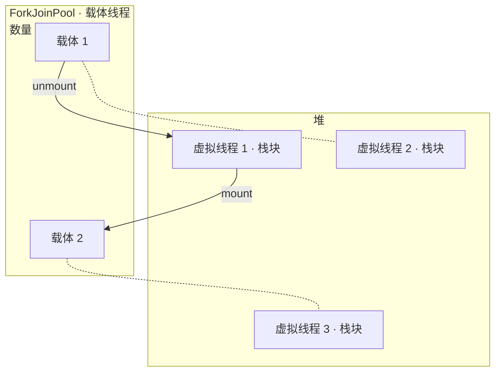
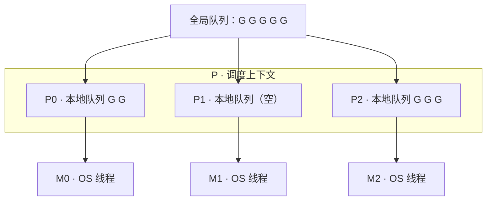

JDK 21 把虚拟线程（Virtual Thread）转为正式特性，Java 从此有了协程。它的用法平淡得出奇：代码还是同步写法，类型还是 `Thread`，只是创建方式换了一下。

```java
Thread.startVirtualThread(() -> {
    var user = userService.findById(42);    // 阻塞 JDBC
    var orders = orderService.listBy(user); // 再阻塞一次
    render(user, orders);
});
```

这段代码跑起来后，两次数据库阻塞都不占用操作系统线程。本文先解释它是怎么做到的，再对比 Go、Rust、Python 的协程实现。四种方案的分歧，最后都落到同一个问题上：栈。

## 协程要解决的问题

函数调用有一个隐含假设：一旦开始，就必须执行到返回。栈是这个假设的载体——参数、局部变量、返回地址依次压入一块线性内存，先进后出，中途不能停。

协程允许执行到一半时停下来，保存现场，之后从停下的位置继续。保存下来的现场叫续体（Continuation），即「剩下的计算」。

实现协程，本质上是把调用栈变成可以保存和恢复的数据。栈存不存在、存在哪里、谁来管理，就是四条路线的全部差异。

## Java：把栈搬上堆

### 工作原理

虚拟线程不直接对应操作系统线程，而是跑在载体线程（carrier thread）上。载体是普通的平台线程，来自一个 ForkJoinPool，数量约等于 CPU 核数。

当虚拟线程执行到阻塞操作（Socket 读写、sleep、park）时，JVM 做三件事：

1. 把当前栈帧从载体栈逐帧拷贝到堆中，存为栈块（stack chunk）；
2. 虚拟线程从载体卸载（unmount），载体立即转去执行其他虚拟线程；
3. 阻塞结束后，把栈块拷回某个载体的栈，继续执行（mount）——不一定是原来那个载体。



「虚拟」的含义是身份与执行资源的分离：`Thread` 对象、ThreadLocal、栈轨迹属于虚拟线程，CPU 时间属于载体。几十万个虚拟线程轮流使用几个载体，这是标准的 M:N 调度。

### 为什么不做 async/await

Java 没有增加任何关键字。`Thread.sleep()`、阻塞 IO 的写法和三十年前一样，挂起能力由 JVM 在内部实现。

原因是存量代码。Servlet、JDBC 和无数框架都是同步写法，如果引入 async，这些代码要沿调用链逐级改写。虚拟线程选择改虚拟机而不是改语言，旧代码原样获得协程能力。

代价转移到了运行时：栈块要在堆和载体栈之间来回拷贝；JDK 21 中 `synchronized` 会把载体线程钉住（pinning），阻塞期间载体无法让出，这个问题到 JDK 24（JEP 491）才解决。

## Go：协程作为默认形态

goroutine 与虚拟线程是近亲：有栈、M:N 调度、无 async 关键字。区别在于 Go 从零设计，协程是默认形态，`go f()` 就是全部语法。

### GMP 调度器

G 是 goroutine，M 是操作系统线程，P 是调度上下文，数量等于核数。P 持有本地运行队列，M 绑定 P 才能执行 G。本地队列空了，先查全局队列，再从其他 P 偷走一半任务。



挂起点分布在所有可能阻塞的地方：channel 收发、网络 IO、锁。网络库统一接入 netpoller（epoll/kqueue/IOCP 的封装），代码是同步写法，运行时是异步执行。

### 栈要多大

有栈协程绕不开这个问题：栈给大了，百万协程内存爆炸；给小了，深递归溢出。

Go 换过一次方案。早期用分段栈，不够就接一段，用指针串联；问题是函数反复跨越段边界时会反复分配释放，形成性能悬崖（hot split）。Go 1.3 改为连续栈：初始 8KB，不够就分配两倍大的新栈，整体拷贝过去，并修正栈上所有指针。能这么做的前提，是运行时精确掌握栈上每个指针的位置——这套信息和 GC 共用。

抢占也分两步走。早期只能在函数入口借栈扩张检查让位，纯协作式，一个死循环可以饿死调度器；Go 1.14 引入基于信号的异步抢占，运行中的线程收到信号后强制让位。

## Rust：没有栈的协程

Rust 把协程从运行时挪进了编译器。

```rust
async fn fetch_user(id: u64) -> User {
    let conn = pool.get().await;    // 挂起点 1
    let row = conn.query(id).await; // 挂起点 2
    row.into()
}
```

这个函数编译后不存在栈。编译器把它改写成一个状态机：每个挂起点对应一个状态，状态里只存跨挂起点存活的局部变量。executor 调用 `poll()`，按当前状态跳到对应位置继续执行；IO 没就绪就返回 `Poll::Pending`，注册 Waker 后交出控制权。

```rust
// 编译后的形态（示意）
enum FetchUser {
    Start     { id: u64 },
    WaitConn  { id: u64 },             // 挂起点 1 的存活变量
    WaitQuery { conn: Conn, id: u64 }, // 挂起点 2 的存活变量
    Done,
}

// poll() 的逻辑
//   Start      -> 发起 pool.get()，进入 WaitConn，返回 Pending
//   WaitConn   -> conn 就绪则发起 query()，进入 WaitQuery，返回 Pending
//   WaitQuery  -> row 就绪则返回 Ready(user)
```

这就是无栈协程（stackless coroutine）：协程从不拥有栈，也就无需保存栈。「剩下的计算」不是运行时抢救出来的栈帧，而是编译期规划好的结构体。挂起只能发生在编译器标记过的位置（`.await`），换来的是每次挂起近乎零成本——没有拷贝，没有切换，状态机还能内联进父状态机，连堆分配都可以省掉。

零成本是字面意思：标准库里没有运行时，tokio 只是可选的 executor 库之一；不用 async，二进制里就没有一行协程代码。

代价有两个。一是函数染色：async 函数只能在 async 上下文中 await，标注沿调用链向上传染。这不是设计失误，而是无栈的必然推论——普通函数没有状态机，无法挂起。二是 `Pin`：状态机的局部变量可能跨挂起点互相引用，一旦移动引用即失效，所以 Future 的内存位置必须固定。这些复杂度由库的编写者承担，换来的是在嵌入式设备上也能运行的协程。

## Python：从生成器演化而来

Python 的协程是一步步长出来的：

- 2.2：生成器（PEP 255），`yield` 让函数可以暂停；
- 2.5：`.send()`（PEP 342），暂停点可以接收值；
- 3.3：`yield from`（PEP 380），生成器之间可以委托；
- 3.5：`async/await`（PEP 492），协程获得独立语法。

机制上与 Rust 同属无栈：生成器的帧对象就在堆上，挂起即停止执行、保留帧。区别在于调度。asyncio 是单线程事件循环，没有抢占，一个协程不让出，整个循环停转。在 GIL 的前提下这是合理选择——反正 Python 线程也做不了并行计算。

## 对比

| 维度 | Java 虚拟线程 | Go goroutine | Rust async | Python asyncio |
| --- | --- | --- | --- | --- |
| 栈模型 | 有栈，栈块存于堆 | 有栈，连续可增长 | 无栈，编译期状态机 | 无栈，生成器帧 |
| 挂起位置 | 任意深度的阻塞点 | 任意深度 | 仅 `.await` | 仅 `await` |
| 函数染色 | 无 | 无 | 有 | 有 |
| 调度器 | ForkJoinPool，work stealing | GMP，work stealing + 信号抢占 | 自选（tokio 等） | 单线程事件循环 |
| 实现层次 | JVM | 语言运行时 | 编译器 + 库 | 库 + 语法糖 |
| 单个成本 | 按需分配的栈块 | 8KB 初始栈 | 状态机的大小 | 一个帧对象 |

规律很直接：有栈协程把复杂度放在运行时，无栈协程把复杂度放在编译器和程序员身上。前者换来不染色的自由，旧代码原样获得挂起能力；后者换来确定性和零运行时依赖。

## 收尾

虚拟线程的意义不在于「Java 也能百万并发」，而在于它把线程的身份和执行资源分开了：身份归虚拟机，CPU 归内核。四种语言做的是同一件事，只是把复杂度放在了不同位置——JVM、语言运行时、编译器，或者程序员自己。
